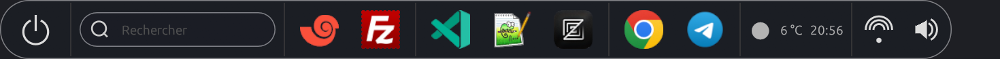
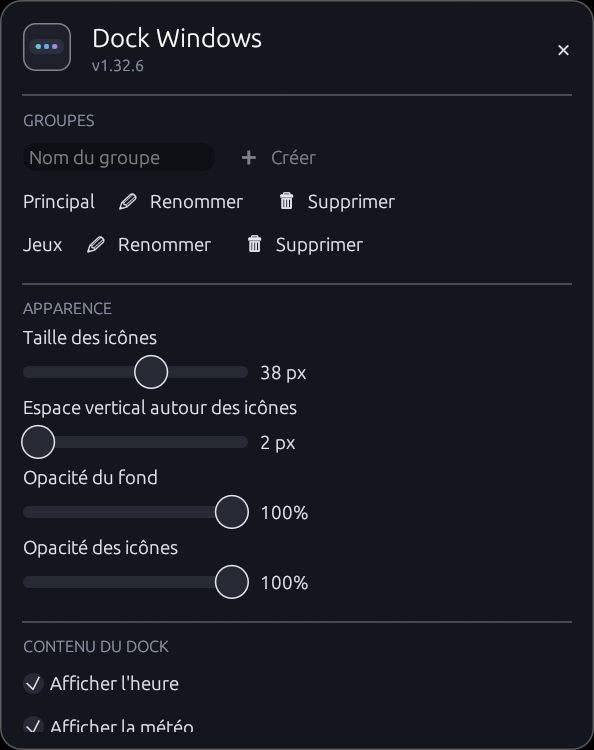

<div align="center">

# Dock Windows

**Un dock Windows léger, écrit en Rust, pour accéder rapidement aux applications et aux fenêtres ouvertes.**


[](https://github.com/xev47/DockWindows/raw/Version-1.32.11/releases/DockWindows-1.32.11-x64.msi)

[English](README.md) · **Français**

</div>

## Présentation

Dock Windows affiche une barre d'icônes sans bordure sur le bord de l'écran
choisi. Elle regroupe les raccourcis épinglés et les fenêtres actuellement
ouvertes. Le dock est une application native indépendante, développée en Rust avec
[egui](https://github.com/emilk/egui).

Le dock Rust, situé dans `rust-dock/`, est un programme autonome.



## Fonctionnalités

- Épingler des fichiers et des dossiers par glisser-déposer.
- Afficher un champ de recherche pour retrouver et lancer les applications du
  menu Démarrer.
- Regrouper les raccourcis dans des groupes personnalisés ; tous les groupes
  sont affichés en même temps dans le dock et séparés par un simple trait.
- Glisser une icône sur les icônes d'un groupe pour y déplacer le raccourci,
  ou pour y épingler une application en cours d'exécution ; un trait indique la
  position d'insertion, ce qui permet aussi de réordonner les raccourcis d'un
  même groupe.
- Déposer des fichiers sur les icônes d'un groupe pour les y épingler.
- Créer, renommer et supprimer les groupes depuis la fenêtre des paramètres ;
  le nom des groupes n'apparaît pas dans le dock.
- Exporter et importer la configuration (groupes, raccourcis et réglages) depuis
  les paramètres, pour la retrouver après une réinstallation ou sur un autre PC.
- Une application déjà épinglée dans un groupe n'apparaît pas une seconde fois
  parmi les applications actives ; une pastille sous l'icône indique qu'elle
  est lancée et le clic bascule sur ses fenêtres.
- Un même raccourci ne peut être épinglé que dans un seul groupe : les doublons
  d'anciennes configurations sont retirés au démarrage.
- Regrouper les fenêtres d'une même application sous une seule icône ; choisir
  une fenêtre à activer grâce aux aperçus miniatures au clic, ou la fermer
  depuis le menu contextuel.
- Gérer les raccourcis avec le menu contextuel.

- Masquer une application en cours d'exécution du dock et la réafficher depuis
  le menu contextuel.
- Régler la taille des icônes, l'espace vertical, l'opacité du fond et celle des
  icônes ; les changements s'affichent en direct dans le dock.
- Activer le démarrage automatique, l'affichage permanent au premier plan,
  l'heure locale, la météo et le bouton d'arrêt avec confirmation.
- Afficher un accès aux réseaux Wi-Fi Windows et régler le volume système
  depuis le dock.
- Choisir indépendamment le côté du bouton d'arrêt et du bloc météo, définir la
  ville météo et utiliser l'interface en français, anglais ou espagnol.
- Placer le dock en haut, en bas, à gauche ou à droite ; il adopte une
  disposition verticale sur les côtés.
- Personnaliser la couleur de fond du dock, du champ de recherche et de sa liste
  de résultats.
- Ajuster et recentrer automatiquement le dock selon son contenu.

Pour ouvrir les paramètres, faites un clic droit sur une icône, le bouton
d'arrêt, l'heure ou la météo ; le panneau affiche le nom de l'application et
sa version. La commande « Quitter » est disponible dans tous les menus
contextuels du dock.
L'affichage de l'heure et de la météo ainsi que le
bouton d'arrêt sont désactivés par défaut. La météo nécessite une connexion
Internet. L'accès Wi-Fi et le contrôle du son sont également désactivés par
défaut ; le Wi-Fi ouvre le sélecteur de réseaux Windows. Le champ de recherche,
également désactivé par défaut, indexe les
raccourcis présents dans les menus Démarrer de l'utilisateur et de Windows.

## Paramètres



Le panneau des paramètres regroupe la gestion des groupes, l'apparence du dock,
les éléments affichés, la position et les couleurs, ainsi que la sauvegarde de
la configuration.

## Installation Windows

L'installateur MSI x64 s'installe dans le profil de l'utilisateur, sans droits
administrateur, dans `%LOCALAPPDATA%\Programs\DockWindows`. Il crée des
raccourcis dans le menu Démarrer et sur le bureau, puis lance le dock à la fin de
l'installation. L'installateur de la dernière version est déposé dans
[`releases/`](releases/) avec son empreinte SHA-256.

**[Télécharger DockWindows-1.32.11-x64.msi](https://github.com/xev47/DockWindows/raw/Version-1.32.11/releases/DockWindows-1.32.11-x64.msi)** · [Empreinte SHA-256](https://github.com/xev47/DockWindows/raw/Version-1.32.11/releases/DockWindows-1.32.11-x64.msi.sha256)

Au premier démarrage, un assistant permet de choisir la langue du dock
(français, anglais ou espagnol) et d'importer les raccourcis Windows : barre des
tâches, bureau et menu Démarrer. Les raccourcis importés sont regroupés par
source dans le dock ; l'assistant peut être ignoré, et ces choix restent
modifiables dans les paramètres.

Le PC cible doit remplir les conditions suivantes ; aucune dépendance
supplémentaire n'est requise :

- Windows 10 ou Windows 11, en 64 bits.
- Aucun environnement Rust, .NET ni runtime Visual C++ à installer : le binaire
  n'utilise que les bibliothèques système de Windows.

L'installateur vérifie ces conditions et affiche un message en français si elles
ne sont pas remplies.

La configuration personnelle (`%APPDATA%\DockWindows`) est conservée lors d'une
mise à jour ou d'une désinstallation. Le dock l'enregistre de façon atomique et
maintient une copie de secours `config.backup.json` qu'il restaure au démarrage
si `config.json` a disparu ou été abîmé. Les boutons « Exporter… » et
« Importer… » des paramètres permettent de sauvegarder la configuration dans un
fichier JSON et de la recharger, notamment après une réinstallation ou sur un
autre PC.

### Mise à jour

Double-cliquez sur le nouveau MSI : la version précédente est remplacée
automatiquement. Si le dock est encore lancé, l'installateur lui demande de se
fermer (et le termine au besoin) afin de pouvoir remplacer l'exécutable.

### Installation silencieuse

Pour déployer le MSI sans interaction, par exemple depuis un partage réseau :

```powershell
msiexec /i .\DockWindows-<version>-x64.msi /qn
```

Ajoutez `LAUNCHDOCK=0` pour ne pas démarrer le dock à la fin de l'installation.
Le MSI produit par `build.ps1` est accompagné d'un fichier `.sha256` permettant
de contrôler son intégrité avec `Get-FileHash`.

Le MSI et l'exécutable ne sont pas signés : au premier lancement, Windows
SmartScreen peut demander une confirmation (« Informations complémentaires »,
puis « Exécuter quand même »).

## Compiler depuis les sources

### Prérequis

- Windows x64 et la chaîne Rust stable.
- Pour générer le MSI : le SDK .NET 9, WiX Toolset v4 et ses extensions UI et
  Util.

Installez WiX et ses extensions depuis PowerShell :

```powershell
dotnet tool install --global wix --version 4.0.5
wix extension add -g WixToolset.UI.wixext/4.0.5
wix extension add -g WixToolset.Util.wixext/4.0.5
```

Après l'installation de l'outil WiX, ouvrez un nouveau terminal si la commande
`wix` n'est pas encore disponible dans le terminal courant.

### Lancer, tester et compiler l'application

Depuis la racine du dépôt :

```powershell
cargo run --manifest-path .\rust-dock\Cargo.toml
cargo test --manifest-path .\rust-dock\Cargo.toml
cargo build --release --manifest-path .\rust-dock\Cargo.toml
```

### Générer l'installateur MSI

```powershell
.\rust-dock\installer\build.ps1
```

Le script compile l'application en Release et produit
`rust-dock\target\installer\DockWindows-<version>-x64.msi` accompagné de son
empreinte SHA-256. Avant chaque mise à
jour du code, incrémentez au minimum le numéro de correctif dans
`rust-dock\Cargo.toml` (par exemple `0.1.0` vers `0.1.1`). La version de
l'installateur suit automatiquement celle du manifeste ; elle peut être
remplacée avec `-Version` pour une génération ponctuelle.

## Configuration et données

Les paramètres sont enregistrés dans
`%APPDATA%\DockWindows\config.json`. Le lancement automatique est géré pour
l'utilisateur courant dans le Registre Windows.

## Structure du dépôt

| Chemin | Description |
| --- | --- |
| `rust-dock/` | Application Windows native en Rust |
| `rust-dock/installer/` | Sources WiX et script de création du MSI |
| `docs/` | Ressources du projet |

## Licence

Ce projet est distribué sous licence **GNU GPL v3.0**.
