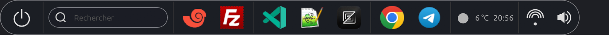
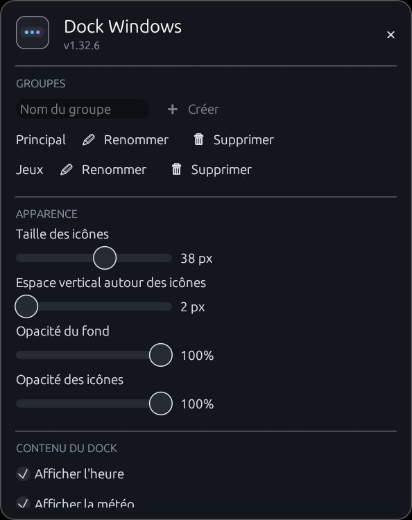

<div align="center">

# Dock Windows

**A lightweight Windows dock, written in Rust, for quick access to applications and open windows.**


[](https://github.com/xev47/DockWindows/raw/Version-1.32.10/releases/DockWindows-1.32.10-x64.msi)

**English** · [Français](README.fr.md)

</div>

## Overview

Dock Windows displays a borderless icon bar on the chosen screen edge. It groups
pinned shortcuts and currently open windows. The dock is a standalone native
application written in Rust with [egui](https://github.com/emilk/egui).

The Rust dock lives in `rust-dock/` and is a self-contained program.



## Features

- Pin files and folders by drag and drop.
- Show a search field to find and launch applications from the Start menu.
- Group shortcuts into custom groups; all groups are shown at once in the dock,
  separated by a thin line.
- Drag an icon onto the icons of a group to move the shortcut there, or to pin a
  running application; a line shows the insertion point, so shortcuts in the same
  group can also be reordered.
- Drop files onto a group's icons to pin them.
- Create, rename and delete groups from the settings window; group names are not
  shown in the dock.
- Export and import the configuration (groups, shortcuts and settings) from the
  settings, to restore it after a reinstall or on another PC.
- An application already pinned in a group is not shown a second time among
  active applications; a dot under the icon indicates that it is running, and
  clicking switches to its windows.
- A shortcut can only be pinned in one group: duplicates from old
  configurations are removed at startup.
- Group the windows of the same application under a single icon; choose a window
  to activate from the thumbnail previews on click, or close it from the context
  menu.
- Manage shortcuts with the context menu.
- Hide a running application from the dock and show it again from the context
  menu.
- Adjust the icon size, vertical spacing, background opacity and icon opacity;
  changes are previewed live in the dock.
- Enable automatic startup, always-on-top, the local time, the weather and the
  shutdown button with confirmation.
- Show an entry point to Windows Wi-Fi networks and adjust the system volume from
  the dock.
- Choose the side of the shutdown button and the weather block independently,
  set the weather city and use the interface in French, English or Spanish.
- Place the dock at the top, bottom, left or right; it switches to a vertical
  layout on the sides.
- Customize the background color of the dock, the search field and its result
  list.
- Automatically fit and recenter the dock to its content.

To open the settings, right-click an icon, the shutdown button, the clock or the
weather; the panel shows the application name and version. The "Quit" command is
available from every dock context menu. The clock, weather and shutdown button
are disabled by default. The weather requires an Internet connection. Wi-Fi
access and sound control are also disabled by default; Wi-Fi opens the Windows
network picker. The
search field, also disabled by default, indexes shortcuts from the user and
Windows Start menus.

## Settings



The settings panel brings together group management, the dock appearance, the
displayed elements, position and colors, and configuration backup.

## Windows installation

The x64 MSI installer installs into the user profile, without administrator
rights, in `%LOCALAPPDATA%\Programs\DockWindows`. It creates shortcuts in the
Start menu and on the desktop, then launches the dock at the end of the
installation. The latest installer is published in [`releases/`](releases/) with
its SHA-256 checksum.

**[Download DockWindows-1.32.10-x64.msi](https://github.com/xev47/DockWindows/raw/Version-1.32.10/releases/DockWindows-1.32.10-x64.msi)** · [SHA-256 checksum](https://github.com/xev47/DockWindows/raw/Version-1.32.10/releases/DockWindows-1.32.10-x64.msi.sha256)

On first start, an assistant lets you choose the dock language (French, English
or Spanish) and import Windows shortcuts: taskbar, desktop and Start menu.
Imported shortcuts are grouped by source in the dock; the assistant can be
skipped, and these choices remain editable in the settings.

The target PC must meet the following conditions; no additional dependencies are
required:

- Windows 10 or Windows 11, 64-bit.
- No Rust, .NET or Visual C++ runtime to install: the binary only uses Windows
  system libraries.

The installer checks these conditions and displays a message in French if they
are not met.

The personal configuration (`%APPDATA%\DockWindows`) is kept across updates and
uninstalls. The dock writes it atomically and keeps a `config.backup.json` backup
that it restores at startup if `config.json` is missing or corrupted. The
"Export…" and "Import…" buttons in the settings let you save the configuration
to a JSON file and load it again, for example after a reinstall or on another PC.

### Updating

Double-click the new MSI: the previous version is replaced automatically. If the
dock is still running, the installer asks it to close (and terminates it if
needed) so it can replace the executable.

### Silent installation

To deploy the MSI without interaction, for example from a network share:

```powershell
msiexec /i .\DockWindows-<version>-x64.msi /qn
```

Add `LAUNCHDOCK=0` to not start the dock at the end of the installation. The MSI
produced by `build.ps1` comes with a `.sha256` file to verify its integrity with
`Get-FileHash`.

The MSI and executable are not signed: on first launch, Windows SmartScreen may
ask for confirmation ("More info", then "Run anyway").

## Building from source

### Prerequisites

- Windows x64 and the stable Rust toolchain.
- To generate the MSI: the .NET 9 SDK, WiX Toolset v4 and its UI and Util
  extensions.

Install WiX and its extensions from PowerShell:

```powershell
dotnet tool install --global wix --version 4.0.5
wix extension add -g WixToolset.UI.wixext/4.0.5
wix extension add -g WixToolset.Util.wixext/4.0.5
```

After installing the WiX tool, open a new terminal if the `wix` command is not
yet available in the current terminal.

### Run, test and build the application

From the repository root:

```powershell
cargo run --manifest-path .\rust-dock\Cargo.toml
cargo test --manifest-path .\rust-dock\Cargo.toml
cargo build --release --manifest-path .\rust-dock\Cargo.toml
```

### Generate the MSI installer

```powershell
.\rust-dock\installer\build.ps1
```

The script builds the application in Release and produces
`rust-dock\target\installer\DockWindows-<version>-x64.msi` with its SHA-256
checksum. Before each code update, increment at least the patch number in
`rust-dock\Cargo.toml` (for example `0.1.0` to `0.1.1`). The installer version
follows the manifest automatically; it can be overridden with `-Version` for a
one-off build.

## Configuration and data

Settings are stored in `%APPDATA%\DockWindows\config.json`. Automatic startup is
managed for the current user in the Windows Registry.

## Repository layout

| Path | Description |
| --- | --- |
| `rust-dock/` | Native Windows application in Rust |
| `rust-dock/installer/` | WiX sources and MSI build script |
| `docs/` | Project assets |

## License

This project is distributed under the **GNU GPL v3.0** license.
